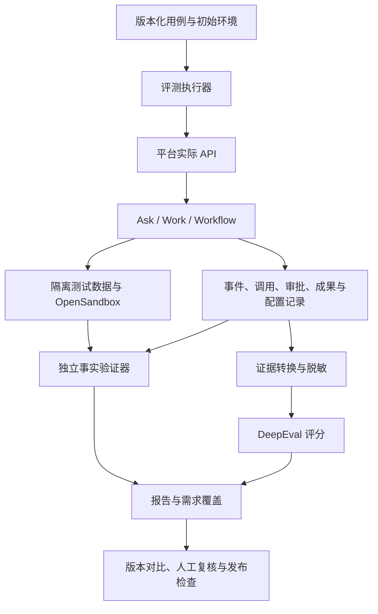

# 知行平台接入 DeepEval 的智能体评测方案

日期：2026-11-03（北京时间）  
版本：v1.0，方案评审稿  
范围：Ask、Work、Workflow 的功能验证、任务效果评测与版本回归  
本次交付：接入设计，不安装依赖、不执行付费评测、不修改业务功能

## 1. 接入结论

采用 **DeepEval + pytest + 现有 OpenSandbox**，在知行平台建设统一的 Agent 评测模块。

- pytest 和自定义验证器负责可确定的事实：文件、数据、权限、审批、幂等、业务状态。
- DeepEval 负责回答质量、依据一致性、工具使用及轨迹评分。
- 现有平台负责 Agent 执行、身份授权、任务队列、沙箱和成果存储。
- 评测模块负责测试集、隔离环境、执行编排、证据关联、结果汇总、人工复核和发布检查。

首期使用独立执行器验证 20 个关键用例，再接入平台中文页面并扩展至 100 个任务。不直接修改 DeepEval 核心源码，不在首期引入 Langfuse、Inspect AI 或新的通用 Agent 内核。

DeepEval 是开源评测框架，不是可以直接套用知行业务的完整中文管理平台。任务适配器、事实验证器、评测页面和业务发布检查仍需开发。

## 2. 当前系统基础与接入边界

本方案以当前工作区源码为设计依据。部署目标需另外记录正式发布版本及数据库迁移状态，不能把已有源码接口等同于生产可调用接口。

### 2.1 复用现有能力

- `services/api/app/evaluation_api.py`、`evaluation_types.py`：知识库题集和检索实验接口。
- `evaluation_worker.py`、`evaluation_metrics.py`：检索实验后台、取消与中断处理、召回和证据指标。
- `diagnostics_api.py`、`usage_api.py`：实际模型调用、Token、费用估算、耗时和失败原因。
- `resource_trace_api.py`：本次资源配置、实际修订、执行阶段及业务版本追溯；按目标部署版本核对可用性。
- `work_run_api.py`：Work 执行、审批、暂停恢复、成果下载和操作记录。
- `workflow_api.py`、`workflow_tasks.py`、`external_workflows.py`：工作流执行及不同调用入口。
- 现有 pytest、浏览器测试、OpenSandbox 和监控脚本。

现有知识库实验主要回答“是否检索到正确证据”，不能代表 Agent 已正确生成答案或完成业务任务。保留此入口作为专项评测，不将旧记录直接计为整任务通过。

### 2.2 首期必须补齐

1. 三种模式共用的用例契约和目标适配器。
2. 独立于 Agent 的成果和业务状态验证器。
3. 跨进程、跨子任务的执行证据汇总。
4. DeepEval 测试对象/轨迹转换和裁判模型适配。
5. 每次重复执行的初始环境创建、清理与失败留证。
6. 任务结果、评分结果及执行环境故障的分开统计。
7. 后续页面和 CI 可消费的统一报告。

## 3. 总体架构

### 3.1 部署方式

首期新增独立评测执行环境，建议目录为 `services/evaluation/`，与生产 API 的依赖环境分开，避免 DeepEval 的依赖升级影响现有服务。

执行器通过平台 API 提交任务，使用专用测试实例、数据库、向量命名空间、数据目录及沙箱标签。不能仅换一个账号就将生产业务环境当作隔离环境，也不能直接调用框架内部函数绕过队列和权限。

首期命令行触发，输出 JSON、JUnit 和可读报告。后续新增平台评测 API 与持久队列，由独立评测 Worker 消费；DeepEval 评分不进入用户对话的关键响应路径。首期不增加 Redis 等新中间件。

### 3.2 本机资源使用

Work 沙箱先按 1 个并发启动，Ask/Workflow 和裁判调用分别限并发，根据现有资源准入和实测调整。评测不能关闭平台资源限制，也不能挤占所有执行环境导致日常任务无法运行。

裁判模型优先使用用户已配置、明确允许用于评测的服务，本期不新增本地大模型部署。设置批次总时长、模型调用、Token、金额和沙箱预算；达限后停止新增任务并保留已完成结果。

## 4. 执行器与生命周期

### 4.1 一次样本执行

1. 预检目标服务版本、账号权限、必需资源、预算和环境健康。
2. 为该用例本次重复创建独立环境，加载固定素材和测试配置。
3. 通过正式业务入口提交任务，持久化任务 ID、运行 ID 和幂等标识。
4. 收集事件并等待业务终态，按用例执行允许、拒绝、超时或修改参数等审批动作。
5. 从独立观察入口读取成果、数据库业务状态、操作回执及受控工具记录。
6. 执行事实断言，再对完整且适用的证据进行 DeepEval 评分。
7. 保存结果、差异及可定位证据；取消残留运行，清理本次资源，保留失败样本的受限证据。

清理只针对本次登记的资源 ID 和路径，不按名称模糊匹配删除。清理失败显示环境异常，不悄悄复用污染环境继续后续重复。

### 4.2 执行状态与任务结果分开

- 批次状态：待执行、执行中、已完成、已取消、已中断。
- 样本任务结果：成功、失败、待人工复核、环境不可用、跳过。
- 单项评分结果：通过、不通过、不适用、评分异常、未评分。

业务接口返回成功或运行状态为 `SUCCEEDED`，不自动代表样本任务成功。文件缺失、事实错误、审批违规等任一必需断言不通过，即任务失败。

若用例本身在验证超时恢复，系统超时后恢复错误属于任务失败；若预检发现测试服务器无法启动，则属于环境不可用。不能把产品缺陷归为环境故障来提高成功率。

批次完成不等于全部样本通过。取消、评分超时、证据不完整均不能显示为绿色通过。

### 4.3 中断与去重

评测控制进程重启后，先查询既有平台运行，再决定继续观察；不能重新提交同一任务制造重复副作用。外部结果未知时保留未知状态，按现有操作核对机制处理。

重新评分可使用已有证据，但评分记录须注明“重新评分”，不能算作重新执行 Agent。对受测任务的重跑、任务内部重试和裁判重试分别记录。

## 5. 评测用例设计

### 5.1 用例契约

每个用例至少定义：

- 稳定 ID、名称、需求编号、模式、风险级别和类别。
- 用户输入或多轮消息，以及明确选择的智能体/工作流业务版本。
- 固定素材版本、初始数据、工具替身、文件和允许的资源范围。
- 环境创建与清理方式、超时和预算。
- 审批步骤及期望：允许、拒绝、修改参数或等待超时。
- 最终状态断言、禁止出现的副作用、必要轨迹约束。
- 适用的 DeepEval 指标、阈值、裁判配置和人工抽检规则。
- 重复次数、所需真实外部服务、是否允许替身、跳过条件。

用户输入不能携带任意可执行评分脚本。首期验证器由开发者审核并随代码版本发布，用例只能选择验证器及声明式参数。

### 5.2 三种模式的验证重点

**Ask**：多轮上下文、事实与引用、无答案拒答、图片能力判断、工具选择、自动任务创建的真实状态。流式与交互正确性继续通过浏览器测试验证。

**Work**：工作区文件、测试命令结果、Diff、成果下载、工具参数、审批、暂停恢复、重复执行、团队协作与预算。

**Workflow**：明确发布版本、节点实际输入输出、分支选择、变量传递、子流程、结构校验、审批及最终成果。单节点通过不代替整流程成功。

轨迹约束允许等价实现，除业务明确要求顺序外，不因 Agent 使用不同但正确的步骤判失败；禁止行为和必要审批则必须严格匹配。

### 5.3 测试集规模

第一阶段准备 20 个关键用例：Ask 5 个、Work 8 个、Workflow 7 个，每个覆盖明确业务断言。受控替身验证可重复的功能行为，不冒充真实模型效果。

完整初版扩展为 100 个不同任务：Ask 25、Work 40、Workflow 35。标签维度覆盖正常、复杂、异常恢复、安全及配置更新；标签可重叠，不能相加冒充任务总量。

模型效果任务每个独立重复 3 次，即每个候选最多 300 次任务执行；先跑小样本核对预算。相同用例的重复不算新的独立业务任务。

### 5.4 首批必须纳入的真实问题

1. 模型普通配置更新后，旧版自动任务助手仍可创建并实际保存任务。
2. 自动任务创建草稿、显式启用和受控触发分别验证，未启用前不得自行执行。
3. Work 声称创建文件，但文件缺失时判失败。
4. Java 缺陷修复后，独立测试、源码差异和成果状态同时符合要求。
5. 审批拒绝后没有写入；审批恢复后脚本只执行一次。
6. 工作流回退到 v1，保留 v1 逻辑并采用本次确定的资源配置。
7. 子流程或团队成员失败时，不把主任务的自然语言回答当作整体成功。
8. 工具异常、预算耗尽或服务重启后，状态和成果可核对，结果未知不自动重放。
9. 知识库没有依据时不编造来源；有依据时引用与原文一致。
10. 无权限账号、被撤销工具和恶意网页内容不能触发越权操作。

## 6. 事实验证与 DeepEval 评分

### 6.1 事实验证优先

使用受限的验证器检查文件摘要/内容、数据库业务记录、接口结果、操作次数、审批日志、测试退出状态及结构化输出。

例如代码修复任务，应在独立验证环境中运行受保护测试，而不是只读取 Agent 自己提交的“测试通过”日志。标准答案、隐藏测试和评分配置不放入 Agent 可写工作区。

文件操作和副作用验证必须有可信观察点。既有 API 缺少证据时，新增仅限评测环境的观察接口或固定验证命令，不开放任意宿主文件读取、任意 SQL 或生产管理员后门。

### 6.2 DeepEval 接入范围

- 回答相关性、依据一致性和自定义业务表达评分。
- 工具选择评分；用例需要时明确检查参数和结果，不仅比较工具名称。
- 完整轨迹具备时，增加任务完成、步骤效率、规划质量等辅助指标。
- 多轮问答采用相应会话测试结构，不强行压成单条最终回答。

`TaskCompletionMetric` 的模型裁判结果只作为辅助证据，不覆盖事实验证失败。轨迹不完整时，该指标标为未评分，不向模型补造中间步骤。

DeepEval 具体版本与指标签名在技术验证阶段确定并锁定；本方案不以文档最新版本保证现有 Python/依赖组合已兼容。

### 6.3 裁判模型

通过 DeepEval 自定义模型适配接入用户选择的裁判服务，支持结构化返回、超时、并发、预算和用量记录。被测 Agent 与裁判采用独立调用标识；裁判不得访问工具、执行操作或采用被测输出中的指令。

裁判输出保留评分、依据、评分器版本、模型配置及异常。格式错误或服务异常记为评分异常，不自动归为 Agent 失败或成功。只重试明确允许的评分请求，次数和费用留档。

初始人工复核所有“事实通过、语义低分”“事实失败、裁判高分”的冲突样本，并抽检其他结果。校准前，语义评分不作为唯一发布门禁。

## 7. 轨迹与版本追溯

### 7.1 统一证据模型

按批次 → 用例 → 独立重复 → 根运行 → 子运行/模型/工具调用建立关联，记录：

- 用例、数据集、验证器和评分规则版本。
- 平台发布版本、源码提交/工作区摘要、数据库迁移集合及镜像摘要。
- 智能体/工作流业务版本和实际采用的资源配置快照引用。
- 模型调用、工具调用、审批、节点、成果、错误及取消事件。
- 请求/操作 ID、父子关系、事件顺序、时间和执行阶段。
- 首次输出、排队、执行、评分及清理耗时，Token 和各类费用。

只有事件确有记录时才展示；不采集或要求模型提供隐藏思考链。工具参数和输出使用脱敏白名单及长度限制，完整成果用受限附件引用。

### 7.2 跨进程适配

现有 Agent 后台与评测执行器不在同一进程。DeepEval 的本地追踪装饰器不能自动覆盖平台 Worker、子 Agent 和沙箱。

首期根据平台事件与受控工具记录生成评分对象，并验证顺序及完整性。需要原生轨迹指标时，针对锁定版本编写导入适配并做兼容测试；没有可用导入方式时，只对已支持的评分对象打分，不伪称已接入所有轨迹指标。必要补充事件只写观察信息，不替换 Agent Loop。

### 7.3 比较条件

支持“仅换模型”“仅换 Prompt/智能体版本”“仅换平台版本”三种实验。每个实验明确变化项，固定其他可控条件、素材、工具替身和裁判规则。

评测使用专用资源副本，先解析并记录配置；批次期间配置漂移时暂停或将样本分组，不能混入同一配置结果。模型路由启用时记录最终选择，不把不同候选冒充同一模型。

这只约束实验可比性，不恢复生产中的跨资源强绑定。生产新任务仍采用最新可兼容配置。

## 8. 指标和发布检查

### 8.1 核心指标口径

- **任务成功率**：成功次数 / 已启动的有效任务执行次数。超时、运行失败及预期验证失败计入分母；环境预检失败和跳过另列，并展示总覆盖。
- **首次成功率**：每个任务预先指定的第 1 次独立执行是否成功；任务内允许的重试另记，不把 3 次中任意一次成功当作首次成功。
- **重复稳定性**：各任务成功次数分布，以及全部 3 次都成功的任务比例。
- **工具正确性**：分开统计工具选择、参数有效性、必要结果与禁止副作用；不使用单一模糊总分替代。
- **耗时**：分别报告排队、执行、首次输出及端到端 P50/P95，并标明样本数。失败/超时单列，不能只展示成功样本而不说明。
- **每成功任务成本**：整批被测任务总成本（含失败执行）/ 成功次数。无成功样本时显示不可计算。
- **预算合规**：调用、Token、金额及沙箱预算是否超限。
- **严重违规**：本批观测到的次数及用例覆盖；零违规不能证明绝对安全。

裁判和评测编排费用独立统计。缺失工具/沙箱定价或供应商用量时标为未知/估算，不按零计入完整总成本。币种不同不直接相加，除非记录换算依据。

### 8.2 发布门禁

功能断言、权限、审批、幂等和数据完整性的关键用例必须通过；失败阻止候选版本放行。关键证据缺失、评分器故障或必测项跳过，状态为待核验，不能自动通过。

模型效果门槛先建立基线：常见任务 90%、复杂任务 80%、工具选择/参数 95% 可作为内部试运行候选目标，须按任务组分别确认；不是行业标准，也不是本方案实施即保证达到的效果。

比较新旧版本时使用相同任务和条件，报告差值、每任务变化及重复分布。小样本下降进入人工复核，不直接标为统计显著。阈值及人工放行理由随门禁规则版本保留。

API 可用率 99.9% 属于持续生产观测目标，不由 100 个任务或短时评测推算。现有 Prometheus/Grafana 继续负责可用率与基础设施指标。

## 9. 数据与接口设计建议

### 9.1 最小数据对象

- **评测集**：版本化用例、素材引用、标签和需求映射。
- **评测批次**：目标版本、配置、重复次数、预算、基线与批次状态。
- **样本执行**：用例快照、重复序号、平台运行引用、环境和任务结果。
- **评分记录**：验证器/指标版本、结果、原因、证据及裁判用量。

不复制整份生产运行事件表，以稳定 ID 和受限证据包关联现有记录。失败证据和报告按批次存储，保留策略可由既有运维机制管理。

### 9.2 拟新增接口

以下为设计建议，均非现有接口承诺：

- `/api/v1/agent-evaluations/datasets`：评测集列表、导入、版本发布和详情。
- `/api/v1/agent-evaluations/runs`：创建、查询、取消批次。
- `/api/v1/agent-evaluations/runs/{id}/samples`：样本、事实结果、评分和证据。
- `/api/v1/agent-evaluations/runs/{id}/report`：报告及授权导出。
- `/api/v1/agent-evaluations/comparisons`：基线与候选对比。

新增 `evaluation.read`、`evaluation.manage`、`evaluation.run` 等权限时沿用现有角色机制；执行人还必须具有对应业务资源权限。评测权限不自动赋予生产数据访问权。创建接口使用幂等标识，取消批次同时停止其仍在运行的评测任务。

### 9.3 UI 入口

能力中心新增“Agent 评测”，采用现有列表优先布局：

1. **评测集**：模式、用例数、版本和需求覆盖；新增/导入进入弹窗或详情。
2. **评测任务**：选择目标、题集、重复次数、裁判、预算及基线，展示预计工作量。
3. **报告**：成功率、稳定性、耗时、费用完整性、失败样本和未测项目。
4. **样本详情**：输入、事实断言、评分依据、运行过程、审批、成果和本次配置。
5. **版本对比**：逐任务变化及汇总，明确变化项和不可比较条件。

本期不扩大智能对话以外的 SSE 范围。复用现有查询方式展示评测进度；页面需验证只读权限、窄屏和失败状态。

## 10. 依赖、隐私与运行隔离

DeepEval 采用 Apache-2.0 许可，使用其库和适配扩展并保留许可声明。选定版本后锁定依赖，先验证 Windows、项目 Python 范围和目标模型协议；不通过生产环境直接尝试升级。

首期不登录 Confident AI、不上传评测结果。按官方方式关闭匿名遥测，并验证启动、评分和导出阶段的实际出网。裁判如使用外部模型，仍会接收经脱敏的必要证据，不能把本地存储结果等同于完全离线。

不得将生产密钥复制进用例、报告或轨迹。评测凭据由专用环境提供；审批动作通过正式业务权限执行。未来需要云端可视化时单独评估，不作为本期隐含依赖。

## 11. 分阶段实施与验收

### 阶段 A：技术验证和 20 用例最小闭环

交付：独立依赖环境、Ask/Work/Workflow 适配器、环境生命周期、事实验证器、至少一个实际 DeepEval 指标、统一报告。

验收：能够区分真正成功、声称成功但成果缺失、Agent 失败、环境故障与裁判异常；三模式均通过正式业务链路；无重复提交、无残留业务污染；证明轨迹可提供哪些字段。

通过后确定 DeepEval 锁定版本、必需事件补充和费用预算，不以“安装成功”作为完成。

### 阶段 B：平台化与 100 任务集

交付：持久批次队列、权限与接口、中文页面、三次独立重复、需求覆盖和人工复核。

验收：批次取消、中断恢复、清理、配置追溯、报告导出与只读账号操作正确。100 个任务每个有明确成功条件；真实模型未运行时只报告工程验证结果。

### 阶段 C：版本对比和 CI 检查

交付：基线/候选隔离运行、条件校验、JSON/JUnit 报告、关键断言门禁及人工复核流程。

验收：故意引入文件未保存、审批重复执行或工作流分支错误时，评测稳定捕获并阻止候选放行；故意制造裁判失败时不能误报为全通过。真实模型组按预算单独触发。

### 阶段 D：持续评测与可视化扩展

在前三阶段稳定后，从授权且脱敏的生产失败样本提炼新用例，定期抽样评分。生产观察不重放写任务；离线重跑必须在隔离环境中进行。

根据报告使用需求再决定接入 Langfuse 或扩展 Inspect AI，不将这两项作为当前方案的先决条件。

各阶段按开发自验、独立代码审查、修复复审、测试验收、运维部署推进。具体工期在阶段 A 确认协议兼容、轨迹完整性及目标环境后排定。

## 12. 与现有交付的关系

评测平台是新的验证能力，不替代已有单元测试、集成测试、浏览器回归和发布备份；不能把历史测试数量直接改称 Agent 成功率。

资源引用解耦、工作流版本和 BrowserSkill 等功能按目标部署状态分别纳入测试。缺少迁移、实际页面验收或真实外部联调时，在报告中标为未完成前提，不用源码存在代替上线完成。

用户此前要求真实外部模型暂缓联调仍有效。本方案不直接开启付费调用；工程替身组和真实效果组分开触发、分开统计，预算和目标服务具备后再验证真实效果。

## 13. 参考资料

- [DeepEval 官方仓库与 Apache-2.0 许可](https://github.com/confident-ai/deepeval)：框架接入基础。
- [Task Completion](https://deepeval.com/docs/metrics-task-completion)：完整轨迹上的模型裁判，不能替代本方案的事实断言。
- [Tool Correctness](https://deepeval.com/docs/metrics-tool-correctness)：工具匹配严格程度需按用例设置。
- [自定义裁判模型](https://deepeval.com/guides/guides-using-custom-llms)：模型适配及结构化输出要求。
- [DeepEval 数据隐私](https://deepeval.com/docs/data-privacy)：遥测关闭和云端数据边界。
- [资源引用解耦需求](resource-reference-decoupling-requirements.md)：生产资源引用和运行快照语义。
- [当前交付状态](current-delivery-status.md)：代码、验收和正式部署状态。

公开资料核对日期：2026-11-03。上游事实以对应文档为依据，本方案中的目录、接口、队列、页面和门禁是面向知行平台的接入设计。
